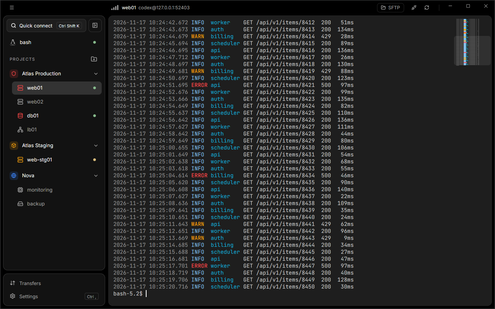
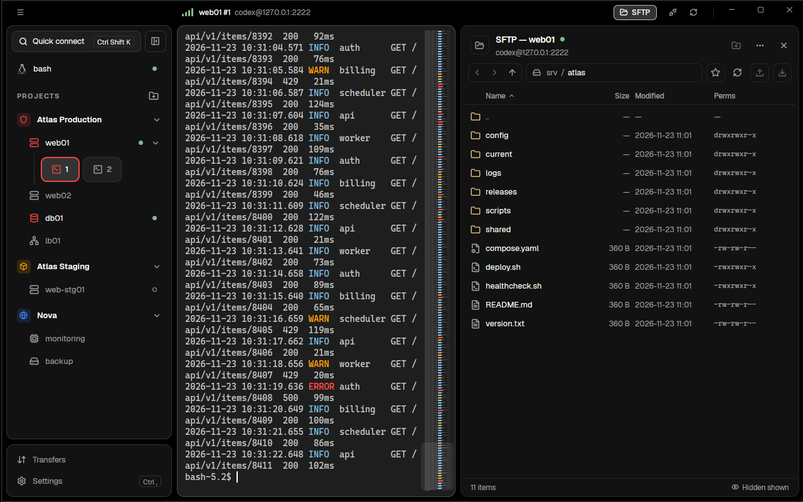
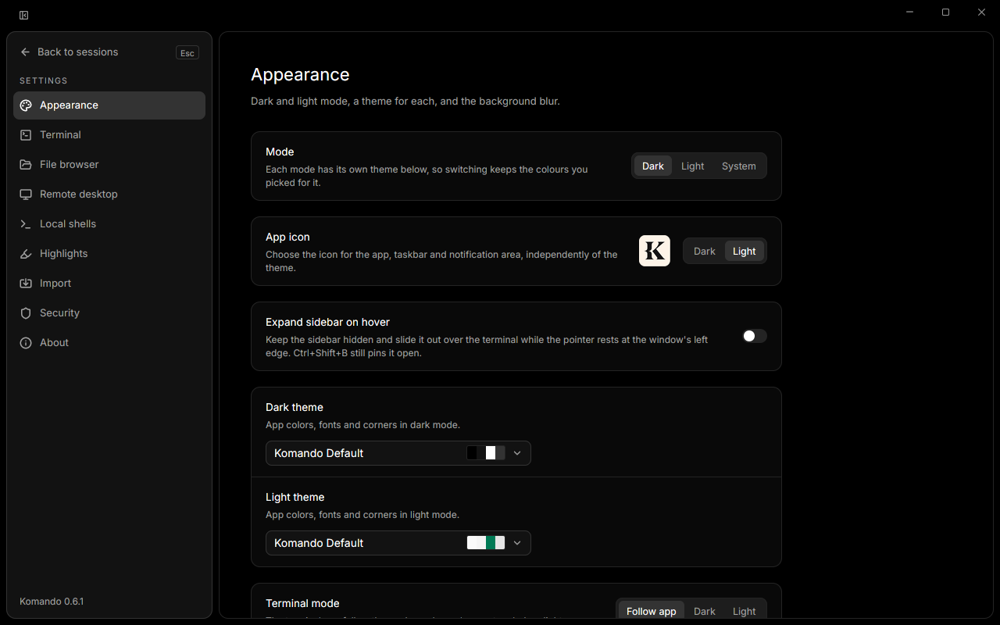
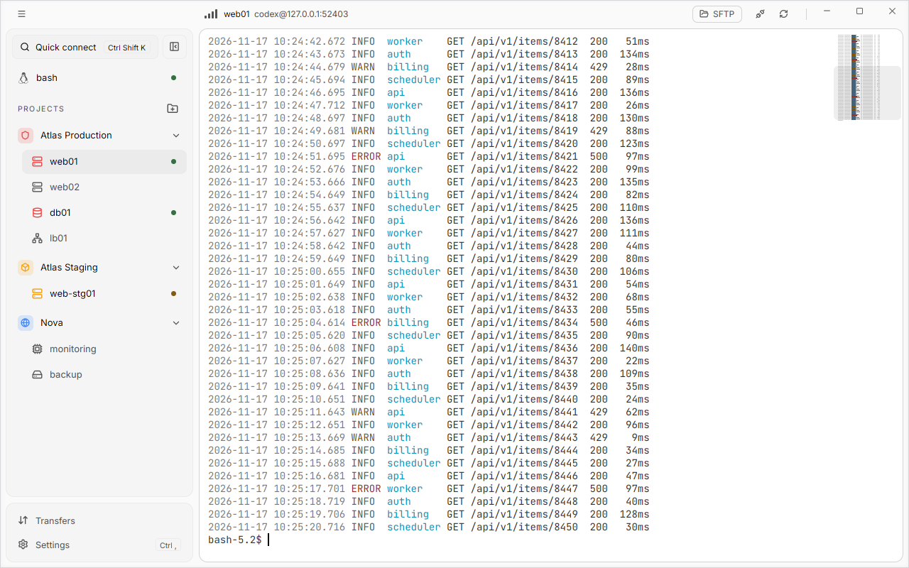

<div align="center">


### Fast and light SSH, SFTP and remote desktop client. Built with Rust.

Your servers, files and remote desktops organized into projects.

[](https://github.com/R4cc/komando/releases/latest)
[](https://github.com/R4cc/komando/releases)


**[Download](#download)** · [Features](#features) · [Performance](#performance) · [Changelog](CHANGELOG.md)

</div>

<br>



## Why Komando

- **Fast and light.** A single native process, rendered on the GPU. Startup time is 187ms, and Komando uses about 29 MB of memory with 10 connected SSH sessions.
- **Organised.** Servers live in projects with their own colour and icon, so you always know
  whether you're typing into staging or production.
- **Additional features**
  - SSH, SFTP, RDP and VNC, a key vault and log highlighting.
  - Startup commands, jump hosts, sudo without retyping.

## Download

| | | |
|---|---|---|
| **Windows installer** | `Komando-<version>-x64.msi` | Recommended. Install for yourself (no admin rights) or for every user of the PC. Updates in one click. |
| **Windows portable** | `Komando-<version>-x64.exe` | One file, nothing to install. Put it anywhere and run it. |
| **Linux** | `Komando-<version>-linux-x86_64.tar.gz` | Unpack it and run `./install.sh` to add Komando to your app menu for your user (it goes in `~/.local`), or run `./komando` from the folder. Built for X11 and Wayland. Needs glibc 2.35 or later (Ubuntu 22.04, Debian 12, Fedora 36 and newer) and libxcb, libxkbcommon and libxkbcommon-x11 (`libxcb1`, `libxkbcommon0` and `libxkbcommon-x11-0` on Debian and Ubuntu, which desktops normally have). |
| **macOS** | `Komando-<version>-macos-arm64.dmg` | Open it and drag Komando to Applications. macOS 12 or later on Apple Silicon. |

**[⬇ Get the latest release](https://github.com/R4cc/komando/releases/latest)** and pick a file
under **Assets**. On Linux and macOS, Komando tells you when a new version is out and opens its
release page; you install it yourself for now.

<details>
<summary><b>Windows SmartScreen warns about the portable EXE</b></summary>
<br>

Komando isn't code-signed yet, so Windows warns about the downloaded `.exe`. Right-click it →
**Properties** → tick **Unblock** → **OK**, or in PowerShell from its folder:

```powershell
Unblock-File .\Komando-*-x64.exe
```

If your company blocks unknown programs entirely (AppLocker), this won't help.
[Building it yourself](docs/development.md#build-it-yourself-on-windows) never triggers the warning.

</details>

<details>
<summary><b>macOS says Komando can't be opened</b></summary>
<br>

Komando isn't notarized by Apple yet. Open it once, then go to **System Settings** → **Privacy &
Security** and click **Open Anyway** next to the message about Komando. Each new version you
download needs this once more. Or, in Terminal:

```sh
xattr -dr com.apple.quarantine /Applications/Komando.app
```

</details>

**First start:** add a project and a host, then click it to connect. The first time Komando saves a
password or key, it asks you to choose a master password for the vault. Your data stays on your
machine: `%APPDATA%\Komando` on Windows, `~/.config/Komando` (or `$XDG_CONFIG_HOME/Komando`) on
Linux and `~/Library/Application Support/Komando` on macOS.

**Coming from Tabby or MobaXterm?** Settings → Import brings your SSH profiles and sessions over.
The experimental MobaXterm importer also brings over direct RDP and VNC sessions; desktop
sessions using an SSH gateway are left out with an explanation. Passwords stay in MobaXterm.

## Features

### Project based approach

- **Projects with colours and icons.** A coloured strip above the terminal shows which
  environment you're in.
- **Quick connect.** <kbd>Ctrl</kbd>+<kbd>Shift</kbd>+<kbd>K</kbd>, type a few letters, pick with
  <kbd>↑</kbd>/<kbd>↓</kbd>, Enter (or Ctrl+Enter for another session).
- **Shared settings per project.** Default user, key or password, jump hosts and startup commands
  set once and inherited by every host.
- **Jump hosts.** Reach servers that sit behind others. Komando shows each hop while connecting.
- **Share a project.** Send a teammate a `.komando` file with its hosts, users and jump hosts,
  never its passwords or keys.
- **Startup commands.** `cd /srv/app`, `sudo -i` or `tmux attach` typed for you once the shell is ready.
  A command can wait for text first, such as the root prompt after `sudo -i`.
- **Several sessions per host**, and **reconnect in place** with your output kept. Ctrl+click a
  host (or hover it and click +) for another terminal; each gets a row under the host that you
  can rename.
- **Sidebar by keyboard.** <kbd>Ctrl</kbd>+<kbd>Shift</kbd>+<kbd>H</kbd>, then arrows to move and
  fold, Enter to connect, Ctrl+Enter for another session, F2 to rename, Delete to disconnect,
  Shift+F10 for the row's menu.
- **Resizable navigation.** Drag the gap beside the sidebar to set its width; Komando remembers it.
- **Local shells too.** On Windows, PowerShell 7, Windows PowerShell, Command Prompt and your WSL
  distributions are detected; add Git Bash yourself. On Linux and macOS, your login shell is offered.

### Remote desktops over RDP and VNC

- **Attached to your hosts.** The host's right-click and ⋯ menus offer RDP and VNC by default.
  Choose an unconfigured protocol to set its port, account and vault password; once saved,
  open it from the same menu. Edit a host → Remote desktop to change either protocol later
  or switch it off to hide it from the menu.
- **Inside Komando.** A desktop opens as a session under its host, with keyboard and mouse
  input, scaling to fit, and reconnect. Choose what a click on the host opens, including a
  desktop for Windows hosts without SSH.
- **Direct or through SSH.** A tunnel on the host's SSH session reaches the desktop port on
  that same machine. VNC defaults to this route because classic VNC leaves screen traffic
  unencrypted. Connect the SSH session first; a waiting desktop then connects automatically.
- **RDP certificate checks** happen before credentials are sent. New or changed certificates
  ask for trust. Settings → Remote desktop controls RDP resizing, VNC sharing and remembered
  certificates. RDP supports TLS and NLA with NTLM; VNC supports no authentication and classic
  VNC passwords. Clipboard, audio and drive redirection, RD Gateway, Kerberos and VNC
  TLS/VeNCrypt are outside this first version. Project sharing covers SSH; the experimental
  MobaXterm import also supports direct RDP and VNC sessions.

### Files over SFTP



- **A file browser beside the terminal**, over the connection you already have. No second login.
- **Upload and download** files and whole folders, or drop them in from Explorer or your file
  manager. Create, rename, copy, move and delete, with sizes, dates and permissions.
- **Favorite folders** like `/var/log`, on every server or just one.
- **Safe with Windows names.** Remote files called `con` or `README` and `readme` side by side
  download without clobbering each other.

### Read logs faster

- **Highlighting for terminal output.** ERROR in red, WARN in orange, `Active: active` in green:
  built-in rules cover Linux and service logs.
- **Your own rules.** Import and export rule sets in Tabby's format. See [Highlights](docs/highlights.md).
- **Minimap.** The whole scrollback in miniature on the right edge, errors and warnings in colour.
  Drag its slider or click to jump. It sits beside the output, or over it until you need it.
- **Command rail.** A mark beside every command you ran. Click one to scroll back to it.
- **Search the scrollback.** Ctrl+Shift+F finds text or a regular expression in all of the
  output, highlights every match and marks them on the minimap; Enter steps back through them.
- **Copy the whole output** as text, or as a `.txt` file to drop into Outlook or Teams. On Linux and
  macOS, the file's path goes on the clipboard instead.

### Secure by default

- **Encrypted vault** for passwords and SSH keys: Argon2id and XChaCha20-Poly1305, locked by your
  master password. Auto-locks after a time you choose while your sessions stay connected.
- **Saves passwords for you** once they work, for one host or the whole project.
- **Sudo without retyping.** When `sudo` asks, press Enter and Komando types the password you signed in with.
- **Server fingerprints checked.** New hosts ask for trust, changed keys are blocked, and your
  OpenSSH `known_hosts` is honoured.
- **OpenSSH and PuTTY (`.ppk`) keys** both work.

### Make it yours

- **Light and dark themes**, with separate app and terminal colours.
- **A light or dark app icon.** Choose either in Settings → Appearance, independently of
  the theme. The choice is remembered. On Windows it also updates the taskbar and notification area;
  on Linux and macOS the icon stays the same for now.



<details>
<summary>Light mode</summary>



</details>

## Performance

Komando is built in Rust for fast startup, low memory use and responsive SSH sessions.

<p align="center">
  
  
</p>

<p align="center"><sub>Komando, Windows Terminal + OpenSSH and Tabby on the same Windows 11 PC. Each metric uses its own scale. Windows Terminal figures are from 2026-11-13 with different settings; Komando and Tabby were measured on 2026-11-14. <a href="docs/benchmarks.md">Method and raw data.</a></sub></p>

### On slow and distant connections

We have optimized throughput and input performance over simulated slow links:

| Metric | Result |
|---|---:|
| Output after Ctrl+C during a flood, 10 Mbit/s, 30 ms | **0.1 s** |
| Output after Ctrl+C during a flood, 100 Mbit/s, 50 ms | **0.1 s** |
| Extra delay on each key while a file uploads, 10 Mbit/s, 30 ms | **25 ms** |
| A million log lines from a Host 25 ms behind a Jump Host 25 ms away | **1.5 s** |

## Keyboard shortcuts

App shortcuts use <kbd>Ctrl</kbd>+<kbd>Shift</kbd>, so plain <kbd>Ctrl</kbd> keys (Ctrl+W, Ctrl+R, …)
still reach the shell on your server. On macOS the same Ctrl+Shift shortcuts work, and the usual
Cmd shortcuts too: <kbd>Cmd</kbd>+<kbd>C</kbd>/<kbd>V</kbd> copy and paste in the terminal,
<kbd>Cmd</kbd>+<kbd>F</kbd> searches, <kbd>Cmd</kbd>+<kbd>T</kbd>/<kbd>W</kbd> open and close a
session, <kbd>Cmd</kbd>+<kbd>,</kbd> opens Settings and <kbd>Cmd</kbd>+<kbd>Q</kbd> quits. Option
types characters such as @ and |; Settings → Terminal can make it the Meta key instead. In a
remote desktop, Cmd is sent as Ctrl.

Settings → Terminal offers **Windows-style keyboard selection** (off by default). When enabled,
Ctrl+A selects the current recognised command; press it again to select all output. With an
unrecognised or empty prompt it selects all output immediately. Ctrl+Shift+A selects all output
instead of copying it. Shift+arrows select characters, Ctrl+Shift+Left/Right select words,
Shift+Home/End select to the line edges, and Ctrl+Shift+Home/End select to the output edges.
Esc clears the selection; Ctrl+Shift+C copies it. Selecting text does not edit the shell's command.
Full-screen programs retain their input keys. Cursor shape and blinking are also configurable
there, with a blinking line as the default.

<details>
<summary>All shortcuts</summary>
<br>

| Action | Keys |
|---|---|
| Quick connect | Ctrl+Shift+K |
| Another session on the current host | Ctrl+Shift+T |
| Disconnect (keeps the output); again to discard it | Ctrl+Shift+W |
| Move into the sidebar / back to the session | Ctrl+Shift+H / Esc |
| Sidebar: move; fold or unfold | ↑ / ↓; ← / → |
| Sidebar: connect; another session | Enter; Ctrl+Enter |
| Sidebar: rename the session (edit an idle host or a project) | F2 |
| Sidebar: disconnect the session (delete an idle host or a project) | Delete |
| Sidebar: edit / delete the host | Shift+F2 / Shift+Delete |
| Sidebar: the row's menu | Shift+F10 or the Menu key |
| Next / previous session | Ctrl+Tab / Ctrl+Shift+Tab |
| Copy / paste | Ctrl+Shift+C / Ctrl+Shift+V |
| Copy whole output as text / as .txt file | Ctrl+Shift+A / Ctrl+Shift+S |
| Search the output; then older / newer match | Ctrl+Shift+F; Enter or ↑ / Shift+Enter or ↓ |
| Search: match case / regular expression | Alt+C / Alt+R |
| Show / hide the SFTP browser | Ctrl+Shift+E |
| Show / hide the sidebar | Ctrl+Shift+B |
| Lock vault | Ctrl+Shift+L |
| Settings | Ctrl+, |

</details>

## FAQ

<details>
<summary><b>Is it an alternative to PuTTY, MobaXterm, Tabby or Windows Terminal?</b></summary>
<br>
Yes, if you mostly work on Linux servers over SSH. Komando combines a GPU-rendered terminal, a
built-in SSH and SFTP client and a server manager, and it reads PuTTY keys, Tabby profiles and
highlight rules, and MobaXterm sessions.
</details>

<details>
<summary><b>Does it need WSL or OpenSSH?</b></summary>
<br>
No. SSH runs inside Komando, so remote output never passes through the Windows console layer.
</details>

<details>
<summary><b>Where are my passwords stored?</b></summary>
<br>
In an encrypted vault on your computer, protected by your master password. Nothing is sent
anywhere. A forgotten master password can't be recovered, but your projects and hosts are stored
separately and survive.
</details>

<details>
<summary><b>How do I uninstall it?</b></summary>
<br>

- **Windows:** remove Komando under Settings → Apps, or delete a portable `komando.exe`.
- **Linux:** run `./uninstall.sh` from the unpacked tarball. It removes the program, menu entry and icon
  from `~/.local`. Without the folder, delete `~/.local/bin/komando`,
  `~/.local/share/applications/komando.desktop` and
  `~/.local/share/icons/hicolor/512x512/apps/komando.png` by hand.
- **macOS:** drag Komando from Applications to the Trash.

Your hosts, settings and vault stay in the data folder listed under **First start**. Delete that
folder too to remove them. On Linux and macOS, terminal output copied as a `.txt` file is in
`~/.cache/Komando` or `~/Library/Caches/Komando`.

</details>

<details>
<summary><b>Which features are Windows-only?</b></summary>
<br>
SSH, SFTP, remote desktops, projects, the vault and themes work on all three systems. For now,
these are Windows-only: in-place updates, the tray icon and minimize to tray, completion
notifications, Mica and background blur, remembering the vault unlock, WSL and administrator
shells, copying text with its colours and styles, copying a file itself to the clipboard, the app
icon switch, and the keyboard hook that sends Windows keys to a remote desktop.
</details>

## Building and contributing

Build instructions, the release process and design notes are in
[docs/development.md](docs/development.md). Terms used in the code are in [GLOSSARY.md](GLOSSARY.md),
and design decisions in [docs/adr](docs/adr).

## License

Komando-authored code is licensed under the [PolyForm Noncommercial License 1.0.0](LICENSE).
You may use, copy, modify and redistribute it for purposes permitted by that license.
Commercial use, including use in commercial applications, is not granted by this license.
Redistributed copies must retain the license and required notices.

Third-party dependencies, vendored code, fonts and icons retain their own licenses and notices.
