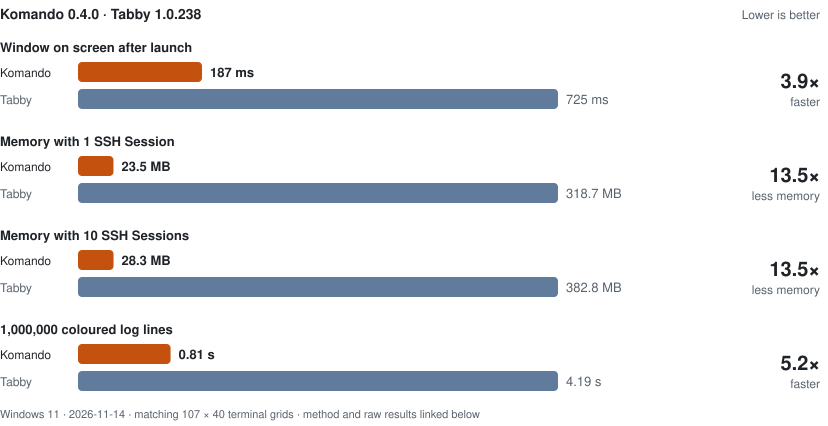
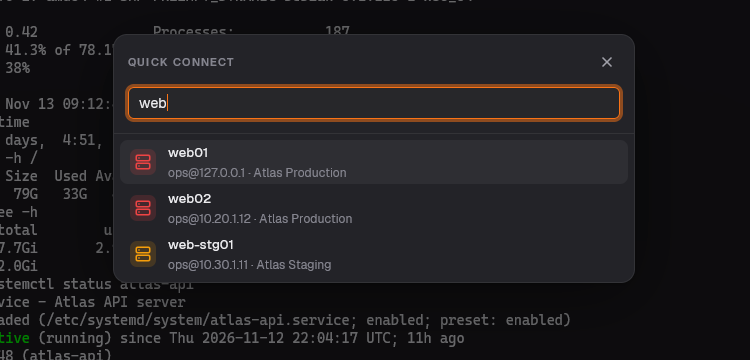
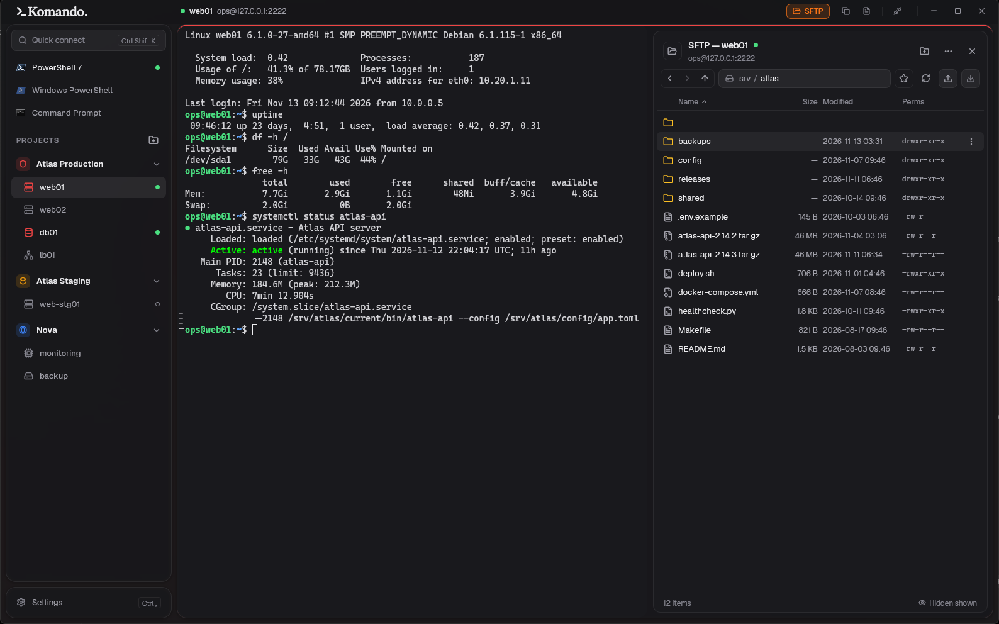
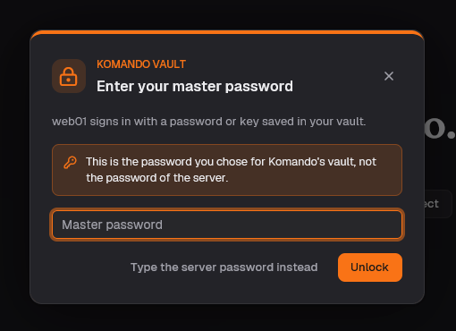

<div align="center">

<picture>
  <source media="(prefers-color-scheme: dark)" srcset="assets/logo-dark.svg">
  
</picture>

### A fast, lightweight SSH terminal for Windows 11

All your Linux servers in colour-coded projects, one click away. Written in Rust, drawn on the GPU.

[](https://github.com/R4cc/komando/releases/latest)
[](https://github.com/R4cc/komando/releases)


**[Download](#download)** · [Features](#features) · [Performance](#performance) · [Changelog](CHANGELOG.md)

</div>

<br>

<p align="center">
  <picture>
    <source media="(prefers-color-scheme: dark)" srcset="assets/benchmark-tabby-dark.svg">
    
  </picture>
</p>

<p align="center"><sub>Komando 0.4.0, Windows Terminal + OpenSSH and Tabby 1.0.238 on the same Windows 11 PC. Each metric uses its own scale. Windows Terminal figures are from 2026-11-13 with different settings; Komando and Tabby were measured on 2026-11-14. <a href="#performance">Method and dates below.</a></sub></p>

<picture>
  <source media="(prefers-color-scheme: light)" srcset="assets/screenshot-light.png">
  
</picture>

## Why Komando

- **Fast and light.** A single native process, rendered on the GPU. The window is up in about a
  quarter of a second, and ten open SSH sessions fit in about 29 MB.
- **Organised.** Servers live in projects with their own colour and icon, so you always know
  whether you're typing into staging or production.
- **Everything built in.** SSH, SFTP, an encrypted password and key vault, log highlighting.
  No WSL, no PuTTY, no OpenSSH setup.
- **Made for people who live in SSH.** Startup commands, jump hosts, sudo without retyping,
  reconnect in place, and every server one keystroke away.

## Download

Komando runs on **Windows 11** (64-bit) only ([why](docs/adr/0001-windows-11-only.md)).

| | | |
|---|---|---|
| **Installer** | `Komando-<version>-x64.msi` | Recommended. Install for yourself (no admin rights) or for every user of the PC. Updates in one click. |
| **Portable** | `Komando-<version>-x64.exe` | One file, nothing to install. Put it anywhere and run it. |

**[⬇ Get the latest release](https://github.com/R4cc/komando/releases/latest)** and pick a file
under **Assets**.

<details>
<summary><b>Windows SmartScreen warns about the portable EXE</b></summary>
<br>

Komando isn't code-signed yet, so Windows warns about the downloaded `.exe`. Right-click it →
**Properties** → tick **Unblock** → **OK**, or in PowerShell from its folder:

```powershell
Unblock-File .\Komando-*-x64.exe
```

If your company blocks unknown programs entirely (AppLocker), this won't help.
[Building it yourself](docs/development.md#build-it-yourself-on-windows) never triggers the warning.

</details>

**First start:** add a project and a host, then click it to connect. The first time Komando saves a
password or key, it asks you to choose a master password for the vault. Your data stays on your
machine in `%APPDATA%\Komando`.

**Coming from Tabby?** Settings → Import brings your SSH profiles over.

## Features

### Every server one click away



- **Projects with colours and icons.** A coloured strip above the terminal shows which
  environment you're in.
- **Quick connect.** <kbd>Ctrl</kbd>+<kbd>Shift</kbd>+<kbd>K</kbd>, type a few letters, Enter.
- **Shared settings per project.** Default user, key or password, jump hosts and startup commands
  set once and inherited by every host.
- **Jump hosts.** Reach servers that sit behind others. Komando shows each hop while connecting.
- **Share a project.** Send a teammate a `.komando` file with its hosts, users and jump hosts,
  never its passwords or keys.
- **Startup commands.** `cd /srv/app`, `sudo -i` or `tmux attach` typed for you once the shell is ready.
  A command can wait for text first, such as the root prompt after `sudo -i`.
- **Several sessions per host**, and **reconnect in place** with your output kept.
- **Local shells too.** PowerShell 7, Windows PowerShell and Command Prompt are detected; add WSL
  or Git Bash yourself.

<br clear="right">

### Read logs faster


- **Highlighting for terminal output.** ERROR in red, WARN in orange, `Active: active` in green:
  69 rules for Linux and service logs are included.
- **Your own rules.** Import and export rule sets in Tabby's format. See [Highlights](docs/highlights.md).
- **Minimap.** The whole scrollback in miniature on the right edge, errors and warnings in colour.
  Drag its slider or click to jump. It sits beside the output, or over it until you need it.
- **Command rail.** A mark beside every command you ran. Click one to scroll back to it.
- **Search the scrollback.** Ctrl+Shift+F finds text or a regular expression in all of the
  output, highlights every match and marks them on the minimap; Enter steps back through them.
- **Copy the whole output** as text, or as a `.txt` file to drop into Outlook or Teams.

<br clear="right">

### Files over SFTP



- **A file browser beside the terminal**, over the connection you already have. No second login.
- **Upload and download** files and whole folders, or drop them in from Explorer. Create, rename,
  copy, move and delete, with sizes, dates and permissions.
- **Favorite folders** like `/var/log`, on every server or just one.
- **Safe with Windows names.** Remote files called `con` or `README` and `readme` side by side
  download without clobbering each other.

### Secure by default



- **Encrypted vault** for passwords and SSH keys: Argon2id and XChaCha20-Poly1305, locked by your
  master password. Auto-locks after a time you choose while your sessions stay connected.
- **Saves passwords for you** once they work, for one host or the whole project.
- **Sudo without retyping.** When `sudo` asks, press Enter and Komando types the password you signed in with.
- **Server fingerprints checked.** New hosts ask for trust, changed keys are blocked, and your
  OpenSSH `known_hosts` is honoured.
- **OpenSSH and PuTTY (`.ppk`) keys** both work.

<br clear="right">

## Performance

Komando was built from the ground up using rust for performance.

| Application | Startup | Memory, 1 idle SSH Session | Memory, 10 idle SSH Sessions | Windows Processes, 10 Sessions | Printing a million log lines |
|---|---:|---:|---:|---:|---:|
| **Komando 0.4.0** | **187 ms** | **23.5 MB** | **28.3 MB** | **1** | **0.81 s** |
| Windows Terminal + OpenSSH* | 351 ms | 29 MB | 127 MB | 21 | 1.4 s |
| Tabby 1.0.238 | 725 ms | 318.7 MB | 382.8 MB | 5 | 4.19 s |

The [method, ranges, raw data and reproduction scripts](docs/benchmarks.md) are included.


### On slow and distant connections

Measured over simulated links in Komando 0.4.0:

| | 0.3.7 | 0.4.0 |
|---|---:|---:|
| Output after Ctrl+C during a flood, 10 Mbit/s, 30 ms | 3.8 s | **0.1 s** |
| Output after Ctrl+C during a flood, 100 Mbit/s, 50 ms | 0.4 s | **0.1 s** |
| Extra delay on each key while a file uploads, 10 Mbit/s, 30 ms | over 0.5 s | **25 ms** |
| A million log lines from a Host 25 ms behind a Jump Host 25 ms away | 2.5 s | **1.5 s** |

Transfers stay as fast as before while keys keep showing promptly: Komando paces how much
output and file data it lets the server send ahead, from the delay it measures on the
connection.

## Keyboard shortcuts

App shortcuts use <kbd>Ctrl</kbd>+<kbd>Shift</kbd>, so plain <kbd>Ctrl</kbd> keys (Ctrl+W, Ctrl+R, …)
still reach the shell on your server.

<details>
<summary>All shortcuts</summary>
<br>

| Action | Keys |
|---|---|
| Quick connect | Ctrl+Shift+K |
| Another session on the current host | Ctrl+Shift+T |
| Disconnect (keeps the output); again to discard it | Ctrl+Shift+W |
| Next / previous session | Ctrl+Tab / Ctrl+Shift+Tab |
| Copy / paste | Ctrl+Shift+C / Ctrl+Shift+V |
| Copy whole output as text / as .txt file | Ctrl+Shift+A / Ctrl+Shift+S |
| Search the output; then older / newer match | Ctrl+Shift+F; Enter or ↑ / Shift+Enter or ↓ |
| Search: match case / regular expression | Alt+C / Alt+R |
| Show / hide the SFTP browser | Ctrl+Shift+E |
| Lock vault | Ctrl+Shift+L |
| Settings | Ctrl+, |

</details>

## FAQ

<details>
<summary><b>Is it an alternative to PuTTY, MobaXterm, Tabby or Windows Terminal?</b></summary>
<br>
Yes, if you mostly work on Linux servers over SSH. Komando combines a GPU-rendered terminal, a
built-in SSH and SFTP client and a server manager, and it reads PuTTY keys and Tabby profiles and
highlight rules.
</details>

<details>
<summary><b>Does it need WSL or OpenSSH?</b></summary>
<br>
No. SSH runs inside Komando, so remote output never passes through the Windows console layer.
</details>

<details>
<summary><b>Where are my passwords stored?</b></summary>
<br>
In an encrypted vault on your computer, protected by your master password. Nothing is sent
anywhere. A forgotten master password can't be recovered, but your projects and hosts are stored
separately and survive.
</details>

<details>
<summary><b>Why Windows 11 only?</b></summary>
<br>
Its users sit at Windows workstations and connect to Linux servers. Supporting one OS lets
Komando use Windows features directly instead of going through cross-platform layers. See
<a href="docs/adr/0001-windows-11-only.md">the decision record</a>.
</details>

## Coming soon

Split view, Windows Hello unlock and changing the master password.

## Building and contributing

Build instructions, the release process and design notes are in
[docs/development.md](docs/development.md). Terms used in the code are in [GLOSSARY.md](GLOSSARY.md),
and design decisions in [docs/adr](docs/adr).
