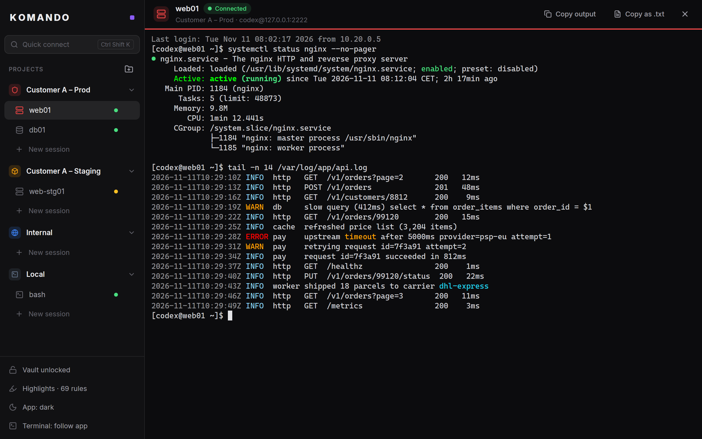
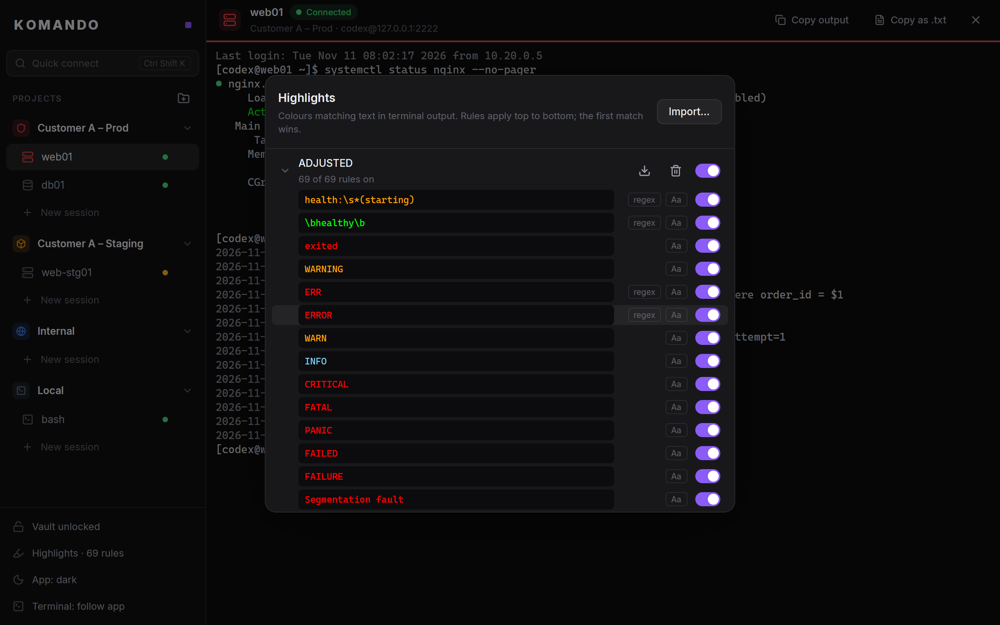

# KOMANDO

A fast terminal for system engineers who work on Linux servers from Windows 11. SSH hosts are organised into projects with their own colours and icons, and passwords and keys live in an encrypted vault.

<picture>
  <source media="(prefers-color-scheme: light)" srcset="assets/screenshot-light.png">
  
</picture>

<sub>Screenshot of the real app. web01 and db01 are live SSH sessions to a local test server (authenticated with a key from the vault). The server prints a scripted demo prompt. web-stg01 is still connecting.</sub>

## What it does

- **Fast output.** Terminal output is parsed on a background thread and drawn on the GPU at most once per frame, so a log flood doesn't block the window. SSH runs inside Komando, so remote output never passes through the Windows console layer (ConPTY).
- **Projects and hosts.** Group hosts into projects, each with a colour and an icon. A thin strip in the project's colour runs above the terminal, so you always see which project you're typing into. A host can belong to several projects and takes the project's colour, default user and password unless it sets its own.
- **Saved passwords.** When a password you typed works, Komando offers to save it for this host or as the project password. Saved passwords and imported keys (OpenSSH and PuTTY `.ppk`) are kept in a vault encrypted with your master password (Argon2id + XChaCha20-Poly1305). The vault locks after 30 minutes idle; open sessions stay connected.
- **Server checks.** On first connect Komando shows the server's fingerprint and asks whether to trust it. If the key later changes, the connection is blocked. Keys you already trusted in `%USERPROFILE%\.ssh\known_hosts` are recognised.
- **Local shells.** PowerShell 7, Windows PowerShell and Command Prompt tabs, organised under projects like SSH sessions.
- **Highlighting.** Rules colour matching text in the output: ERROR in red, WARN in orange, `Active: active` in green, and so on. Import and export rule sets as JSON in Tabby's highlight format (see [Highlights](#highlights)).
- **Copy the whole output.** Copy a session's entire scrollback as text, or as a `.txt` file you can paste straight into Explorer, Outlook or Teams.
- **Light and dark.** The app and the terminal each have their own light/dark setting.

## Highlights



Open the panel from **Highlights** at the bottom of the sidebar. A set of 69 rules for typical Linux and service logs is included.

- **Order matters.** Rules apply top to bottom and the first match wins, so put specific rules (`WARNING`, `Active: inactive`) above general ones (`WARN`, `Active`).
- **Format.** Same as Tabby's highlight plugin, so sets move between the two apps:

  ```json
  { "id": "…", "name": "Ops", "keywords": [
      { "text": "ERROR", "enabled": true, "foreground": true, "foregroundColor": "#FF0000", "isCaseSensitive": true },
      { "text": "health:\\s*(starting)", "isRegExp": true, "isMatchGroup": true, "matchGroup": "1", "foreground": true, "foregroundColor": "#FFA500" }
  ] }
  ```

  Plain `text` matches anywhere in a line. `isRegExp` rules use Rust regex syntax, which covers the usual JavaScript syntax except look-around and back-references; rules that can't be used are listed in the panel. With `isMatchGroup`, only the capture group named in `matchGroup` is coloured. `background`/`backgroundColor` and `bold` work too.
- **Import / export.** Import accepts one set or a list of sets. A set with the same `id` replaces the existing one. Export writes one set. Fields Komando doesn't use are kept, so an exported file matches what was imported.
- **Where they apply.** Highlights are skipped in full-screen programs (vim, less, htop), and each screen row is matched on its own. On a light terminal, very bright colours are darkened so they stay readable.
- **Storage.** Sets are kept in `%APPDATA%\Komando\highlights.json`. Adding and editing individual rules inside the app is not available yet: edit the JSON and re-import.

## Shortcuts

All app shortcuts use Ctrl+Shift, so plain Ctrl keys (Ctrl+W, Ctrl+K, Ctrl+R, …) still reach the shell.

| Action | Keys |
|---|---|
| Quick connect | Ctrl+Shift+K |
| New session in current project | Ctrl+Shift+T |
| Close session | Ctrl+Shift+W |
| Next / previous session | Ctrl+Tab / Ctrl+Shift+Tab |
| Copy / paste | Ctrl+Shift+C / Ctrl+Shift+V |
| Copy whole output as text | Ctrl+Shift+A |
| Copy whole output as .txt file | Ctrl+Shift+S |
| Lock vault | Ctrl+Shift+L |
| Scroll a page | Shift+PageUp / Shift+PageDown |

Pasting more than one line asks for confirmation first.

## Install

Download `Komando-<version>-x64.msi` from [Releases](../../releases). Komando runs on Windows 11 only ([why](docs/adr/0001-windows-11-only.md)).

Data lives in `%APPDATA%\Komando`:

| File | Contents |
|---|---|
| `library.toml` | Projects and hosts (no secrets) |
| `settings.toml` | Theme, font, scrollback size, auto-lock |
| `vault.json` | Encrypted passwords and keys |
| `known_hosts` | Trusted server keys |
| `highlights.json` | Highlight rule sets |

There is no recovery for a forgotten master password. The vault can't be opened without it, but projects and hosts are stored separately and survive.

## Build from source

```powershell
cargo build --release      # target\release\komando.exe
cargo test --lib
```

### Making a release

Publish a GitHub release with a tag like `v0.2.0`. The [release workflow](.github/workflows/release.yml) builds Komando on Windows and attaches `Komando-0.2.0-x64.msi` and the plain `.exe` to the release. To rebuild an existing release, run the workflow manually with its tag.

### Developing on Linux

Komando ships for Windows only, but it also builds on Linux, which is handy for tests and screenshots. You need the X11 libraries (`libxcb`, `libxkbcommon`, `libxkbcommon-x11`). Set `RUST_FONTCONFIG_DLOPEN=on` if fontconfig has no pkg-config file. `examples/demo.rs` seeds a throwaway data folder and opens a few sessions; it's what produced the screenshot above.

## Not in this version yet

Search in output (Ctrl+F), editing and deleting hosts and projects in the app (for now edit `library.toml`), a settings screen, jump hosts, split view, Windows Hello unlock, locking the vault when Windows locks, and an icon for the `.exe`.

## Design notes

- [GLOSSARY.md](GLOSSARY.md): the terms used in code and docs (Project, Host, Session, Vault, …).
- [docs/adr](docs/adr): decisions and why: Windows only, embedded SSH client, native GPU UI, master-password vault.
